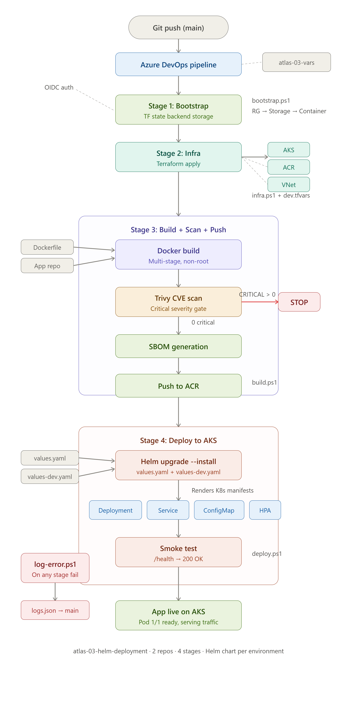

# Atlas-03: Kubernetes Deployment with Helm

Deploy a production-grade FastAPI application to AKS using a custom Helm chart — with per-environment configuration, health probes, resource management, and horizontal pod autoscaling.

**Project 3 of 11** in the [Atlas Platform](https://github.com/manoj-2606) cloud portfolio.

## Architecture

```
┌─────────────────────────────────────────────────────────┐
│                    ADO Pipeline                         │
│  azure-pipelines.yml → calls .ps1 PowerShell engines   │
├─────────────────────────────────────────────────────────┤
│                                                         │
│  ┌──────────┐   ┌──────────┐   ┌──────────┐            │
│  │bootstrap │──▶│ infra    │──▶│ build    │──▶ ...      │
│  │  .ps1    │   │  .ps1    │   │  .ps1    │             │
│  │ Backend  │   │ TF Apply │   │ Docker+  │             │
│  │ Storage  │   │ AKS+ACR  │   │ Trivy+   │             │
│  └──────────┘   └──────────┘   │ ACR Push │             │
│                                └──────────┘             │
│                                      │                  │
│                                      ▼                  │
│                              ┌──────────────┐           │
│                              │  deploy.ps1  │           │
│                              │ Helm Install │           │
│                              │ Smoke Test   │           │
│                              └──────┬───────┘           │
└─────────────────────────────────────┼───────────────────┘
                                      │
                                      ▼
┌─────────────────────────────────────────────────────────┐
│                 AKS Cluster (B2s)                       │
│  ┌─────────────────────────────────────────────┐        │
│  │  Namespace: atlas                           │        │
│  │                                             │        │
│  │  ┌──────────────────┐  ┌─────────────────┐  │        │
│  │  │   Deployment     │  │    Service       │  │        │
│  │  │ atlas-platform-  │  │  ClusterIP :80   │  │        │
│  │  │   app            │  │  → targetPort    │  │        │
│  │  │                  │  │    :8000          │  │        │
│  │  │  ┌────────────┐  │  └─────────────────┘  │        │
│  │  │  │  Pod       │  │                       │        │
│  │  │  │ /health ←──│──│── liveness probe      │        │
│  │  │  │ /health ←──│──│── readiness probe     │        │
│  │  │  │ /metrics   │  │                       │        │
│  │  │  │ /info      │  │  ┌─────────────────┐  │        │
│  │  │  └────────────┘  │  │   ConfigMap      │  │        │
│  │  └──────────────────┘  │  APP_ENV=dev     │  │        │
│  │                        │  APP_VERSION=1.0 │  │        │
│  │                        └─────────────────┘  │        │
│  └─────────────────────────────────────────────┘        │
└─────────────────────────────────────────────────────────┘
```



---

## What is Helm?

Helm is a **package manager for Kubernetes** — the same concept as apt for Linux or pip for Python, but for K8s resources.

Without Helm, deploying an application means writing and managing individual YAML files for each Kubernetes resource: Deployment, Service, ConfigMap, HPA, and more. Every environment (dev, staging, prod) needs its own copy of these files with different values. Change a label? Edit every file. Scale replicas? Edit the Deployment YAML directly. This does not scale.

Helm solves this with two concepts:

1. **Charts**: A package of templated Kubernetes manifests. Instead of hardcoding values, you write `{{ .Values.replicaCount }}` and Helm injects the value at install time.

2. **Values files**: Configuration knobs. One file per environment. The chart stays the same — only the values change.

```
Without Helm:                    With Helm:
├── dev/                         ├── charts/atlas-platform/
│   ├── deployment.yaml          │   ├── templates/
│   ├── service.yaml             │   │   ├── deployment.yaml  ← templated
│   └── configmap.yaml           │   │   ├── service.yaml     ← templated
├── staging/                     │   │   └── configmap.yaml   ← templated
│   ├── deployment.yaml          │   ├── values.yaml          ← prod defaults
│   ├── service.yaml             │   └── values-dev.yaml      ← dev overrides
│   └── configmap.yaml           │
└── prod/                        └── ONE chart. Multiple values files.
    ├── deployment.yaml               No duplication.
    ├── service.yaml
    └── configmap.yaml
```

### Chart Anatomy

```
charts/atlas-platform/
├── Chart.yaml          # Metadata: chart name, version, app version
├── values.yaml         # Default values (production-grade)
├── values-dev.yaml     # Dev overrides (lower resources, single replica)
└── templates/
    ├── _helpers.tpl    # Named templates — reusable label/name blocks (DRY)
    ├── deployment.yaml # Pod spec, probes, resources, env vars
    ├── service.yaml    # ClusterIP — internal networking
    ├── configmap.yaml  # Non-sensitive app configuration
    └── hpa.yaml        # Autoscaler (conditional — disabled in dev)
```

**Chart.yaml** has two version fields:
- `version`: The chart's own version. Bump when you change templates or structure.
- `appVersion`: The application version inside the chart. Bump when your app releases.

These are independent. You can update the chart (add a new template) without changing the app, and vice versa.

### Values Hierarchy

Helm merges values in this priority order (highest wins):

```
1. --set flags on CLI         (highest priority)
2. -f values-dev.yaml         (environment file)
3. values.yaml                (chart defaults — lowest priority)
```

In this project, the pipeline runs:
```bash
helm upgrade --install atlas-platform-app ./charts/atlas-platform \
  -f charts/atlas-platform/values-dev.yaml \
  --set image.repository=acratlas03dev.azurecr.io/atlas-platform-app \
  --set image.tag=20261101.1
```

Result: values.yaml defaults load first. values-dev.yaml overrides replicaCount, resources, HPA. Then --set injects the image coordinates from the pipeline.

### How AKS Consumes Helm Releases

When you run `helm upgrade --install`, Helm:

1. **Reads** all values (defaults + overrides + --set flags)
2. **Renders** every template in `templates/` by injecting values → produces plain Kubernetes YAML
3. **Applies** the rendered YAML to the cluster via the K8s API (same as `kubectl apply`)
4. **Stores** the release as a Secret in the target namespace (named `sh.helm.release.v1..v`)

There is no Tiller (removed in Helm 3). Helm talks directly to the K8s API using your kubeconfig. The release Secret stores the full rendered manifest so Helm can diff, upgrade, and rollback.

```bash
# See what Helm would render (without applying)
helm template atlas-platform-app ./charts/atlas-platform -f charts/atlas-platform/values-dev.yaml

# See stored releases
helm list -n atlas

# See release history (for rollback)
helm history atlas-platform-app -n atlas

# Rollback to previous version
helm rollback atlas-platform-app 1 -n atlas
```

---

## Kubernetes Concepts Used

### Liveness vs Readiness Probes

Both hit the same endpoint (`/health`) but serve different purposes:

| Probe | Question | On Failure |
|---|---|---|
| **Liveness** | "Is this container alive?" | K8s **kills and restarts** the pod |
| **Readiness** | "Can this container serve traffic?" | Pod **removed from Service endpoints** (no traffic routed) |

**Why both matter:**

A container can be alive but not ready. Example: the app is running but still loading configuration or warming a cache. Liveness passes (don't kill it), but readiness fails (don't send traffic yet).

A container can also be stuck (deadlock). Liveness fails → K8s restarts it automatically. Without a liveness probe, a deadlocked container runs forever serving nothing.

```yaml
# In deployment.yaml:
livenessProbe:
  httpGet:
    path: /health        # Must match an actual endpoint in the app
    port: 8000
  initialDelaySeconds: 10  # Wait 10s before first check (app startup)
  periodSeconds: 15        # Check every 15s
  failureThreshold: 3      # 3 consecutive failures → restart

readinessProbe:
  httpGet:
    path: /health
    port: 8000
  initialDelaySeconds: 5   # Shorter — we want traffic routing to start fast
  periodSeconds: 10
  failureThreshold: 3      # 3 failures → remove from service
```

**Interview tip:** If asked "your pod is running but not receiving traffic" — check readiness probe. If asked "your pod keeps restarting" — check liveness probe thresholds and startup time.

### Resource Requests vs Limits

Every container should declare how much CPU and memory it needs. Without these, Kubernetes cannot make intelligent scheduling decisions.

| Field | What It Means | What Happens |
|---|---|---|
| **requests.cpu** | "Guarantee me at least this much CPU" | Scheduler uses this to place pods on nodes |
| **requests.memory** | "Guarantee me at least this much memory" | Pod gets this memory reserved |
| **limits.cpu** | "Never let me exceed this CPU" | Container gets throttled (slowed down) |
| **limits.memory** | "Never let me exceed this memory" | Container gets **OOMKilled** (killed + restarted) |

**QoS Classes** (determined by how you set requests and limits):

| Class | Condition | Eviction Priority |
|---|---|---|
| **Guaranteed** | requests == limits for both CPU and memory | Last to be evicted |
| **Burstable** | requests < limits (this project) | Middle |
| **BestEffort** | No requests or limits set | **First evicted** under pressure |

This project uses Burstable (requests < limits) — the container can burst above its request when the node has spare capacity, but gets killed if it exceeds the memory limit.

```yaml
# values.yaml (prod):
resources:
  requests: { cpu: 100m, memory: 128Mi }   # Guaranteed floor
  limits:   { cpu: 250m, memory: 256Mi }    # Hard ceiling

# values-dev.yaml (dev):
resources:
  requests: { cpu: 50m, memory: 64Mi }     # Lower for B2s node
  limits:   { cpu: 150m, memory: 128Mi }
```

### ConfigMap: Separating Config from Code

The app reads `APP_ENV` and `APP_VERSION` from environment variables. Instead of baking these into the Docker image (which would require a rebuild for every config change), they are externalized into a ConfigMap.

```
ConfigMap → mounted as env vars → container reads via os.environ
```

The Deployment references the ConfigMap with `envFrom`:
```yaml
envFrom:
  - configMapRef:
      name: atlas-platform-app-config
```

**Config change without rebuild:** Update the ConfigMap value in values-dev.yaml → `helm upgrade` → Deployment detects the change (via the `checksum/config` annotation) → rolling restart with new config. No Docker build needed.

### HPA: Horizontal Pod Autoscaler

The HPA watches pod CPU utilization and scales replicas up or down:

```
CPU > 70% for sustained period → add pods (up to maxReplicas)
CPU < 70% and stable           → remove pods (down to minReplicas)
```

Disabled in dev (single B2s node has ~2 vCPUs — no headroom for multiple replicas). Enabled in prod via values.yaml defaults.

Test it with: `POST /simulate/load?duration=60&intensity=high` → watch pods scale.

---

## Pipeline Pattern: PowerShell Engines

This project introduces a different execution pattern from P1 and P2.

**P1** used inline Bash scripts in the pipeline YAML.
**P2** used Bash script files (`scripts/scan-trivy.sh`, `scripts/generate-sbom.sh`).
**P3** uses PowerShell `.ps1` script files as self-contained engines.

```
┌─────────────────────────┐     ┌─────────────────────────────┐
│   azure-pipelines.yml   │     │   scripts/*.ps1              │
│   (thin orchestrator)   │────▶│   (self-contained engines)   │
│                         │     │                              │
│   - Stage ordering      │     │   - Tool installation        │
│   - Parameter wiring    │     │   - OIDC auth setup          │
│   - Environment gates   │     │   - All business logic       │
│   - Repo checkout       │     │   - Error handling           │
└─────────────────────────┘     └─────────────────────────────┘
```

**Why this pattern:**
- Scripts are testable outside the pipeline (run locally with `pwsh ./scripts/infra.ps1 -Action plan ...`)
- Real teams use mixed tooling: Bash for Linux, PowerShell for Azure-heavy operations
- Demonstrates range: P1=inline Bash, P2=Bash scripts, P3=PowerShell scripts, P4+=more patterns

Each script reads Terraform outputs from shared state independently. No fragile pipeline variable passing between stages.

## Multi-Repo Checkout

The app source lives in `atlas-platform-app` (separate repo). This project repo owns everything else: Dockerfile, Helm chart, Terraform, scripts, pipeline YAML.

At pipeline runtime, ADO checks out both repos side by side:
```
$(Build.SourcesDirectory)/
├── atlas-03-helm-deployment/    ← this repo (Dockerfile, charts, terraform, scripts)
└── atlas-platform-app/          ← app repo (Python source only)
```

Docker builds with `-f` flag pointing to this repo's Dockerfile, using the app repo as build context:
```bash
docker build \
  -f atlas-03-helm-deployment/Dockerfile \
  -t acr-server/atlas-platform-app:tag \
  atlas-platform-app/
```

**Why separate repos:** The platform team owns infrastructure and deployment. The app team owns application code. Changes to infra don't trigger app builds and vice versa. This is how real organizations structure their repositories.

---

## Repo Structure

```
atlas-03-helm-deployment/
├── terraform/
│   ├── main.tf                  # Calls atlas-infra-base module (AKS+ACR+VNet)
│   ├── variables.tf             # Project-specific inputs
│   ├── outputs.tf               # Pass-through outputs for pipeline scripts
│   └── dev.tfvars               # Dev environment values
├── Dockerfile                   # Multi-stage, non-root, <100MB
├── charts/
│   └── atlas-platform/
│       ├── Chart.yaml           # Chart metadata (name, version, appVersion)
│       ├── values.yaml          # Prod defaults (2 replicas, HPA on)
│       ├── values-dev.yaml      # Dev overrides (1 replica, HPA off, lower resources)
│       └── templates/
│           ├── _helpers.tpl     # Named templates (labels, fullname, selectors)
│           ├── deployment.yaml  # Pod spec, probes, resources, securityContext
│           ├── service.yaml     # ClusterIP service
│           ├── configmap.yaml   # APP_ENV, APP_VERSION
│           └── hpa.yaml         # Conditional HPA (disabled in dev)
├── scripts/
│   ├── bootstrap.ps1            # Create backend storage (idempotent)
│   ├── infra.ps1                # Terraform init/plan/apply with OIDC
│   ├── build.ps1                # Docker build + Trivy scan + ACR push
│   ├── deploy.ps1               # Helm install + rollout wait + smoke test
│   └── destroy.ps1              # Terraform destroy + backend cleanup
├── docs/
│   └── architecture.png         # Architecture diagram
├── azure-pipelines.yml          # Deploy pipeline (4 stages)
├── azure-pipelines-destroy.yml  # Destroy pipeline (manual trigger)
├── .pre-commit-config.yaml      # gitleaks + terraform_fmt + terraform_validate
├── .gitignore
├── logs.json                    # Error tracking (filled during build)
└── README.md
```

---

## Prerequisites

1. **Azure Pay-As-You-Go subscription**
2. **ADO project** `Atlas-Platform` with service connection `MI-ADO-API` (OIDC/Workload Identity)
3. **Repos in ADO:**
   - `atlas-03-helm-deployment` (this repo)
   - `atlas-platform-app` (app source — must exist in same ADO project)
4. **Variable group** `atlas-03-vars`:
   - `serviceConnection` = `MI-ADO-API`
   - `backendResourceGroup` = `rg-atlas-tfstate`
   - `backendStorageAccount` = `atlastfstate2606`
   - `backendContainer` = `tfstate`
   - `backendKey` = `atlas-03.tfstate`
   - `location` = `centralindia`
5. **ADO environments:** `atlas-03-deploy`, `atlas-03-destroy` (with approval checks)

## Deploy

1. Push code to ADO repo `atlas-03-helm-deployment`
2. Create pipeline from `azure-pipelines.yml`
3. Run the pipeline
4. Approve the `atlas-03-deploy` environment gate
5. Verify: pipeline smoke test hits `/health` → `{"status": "healthy"}`

## Cleanup

1. Run the destroy pipeline (`azure-pipelines-destroy.yml`)
2. Approve the `atlas-03-destroy` environment gate
3. Verify in Azure Portal → Resource Groups → confirm `rg-atlas-03-dev` and `rg-atlas-tfstate` are deleted

---

## Cost

| Resource | Cost |
|---|---|
| AKS control plane | Free |
| 1x Standard_B2s node (~8 hrs) | ~₹28 |
| ACR Basic (~8 hrs) | ~₹15 |
| VNet / NSG | Free |
| **Total** | **~₹45-50** |

### FinOps Decisions

- **Standard_B2s over D2s** — burstable, 60% cheaper. Sufficient for single-app non-prod.
- **Basic ACR** — no geo-replication needed. ₹15/day vs ₹60/day for Standard.
- **HPA disabled in dev** — single node, no scaling headroom. Enabled in prod via values.yaml.
- **Cost tags on every resource** — via atlas-infra-base module `default_tags`. Full cost attribution in Azure Cost Management.
- **Ephemeral infrastructure** — created and destroyed same day. Zero overnight cost.

---

## Security Controls

| Control | Implementation |
|---|---|
| Non-root container | `securityContext.runAsUser: 1000` + Dockerfile `USER atlas` |
| No privilege escalation | `allowPrivilegeEscalation: false` |
| SA token disabled | `automountServiceAccountToken: false` |
| CVE gate | Trivy scan BEFORE push — zero CRITICAL CVEs reach ACR |
| No stored credentials | OIDC in pipeline, AcrPull role for AKS managed identity |
| Secrets scanning | gitleaks pre-commit hook |
| ACR admin disabled | Identity-based access only |

---

## Versus Previous Projects

| Aspect | P1 (IaC Foundation) | P2 (Container Security) | P3 (Helm Deployment) |
|---|---|---|---|
| Focus | Terraform from scratch | Docker + scanning | Helm + AKS deployment |
| Infra | Standalone TF | Standalone TF (ACR only) | atlas-infra-base module |
| Pipeline scripts | Inline Bash + .ps1 | Bash script files | PowerShell .ps1 engines |
| App deployed? | No | Image built only | **Yes — running on AKS** |
| K8s resources | None | None | Deployment, Service, ConfigMap, HPA |

---

## Lessons Learned

*Populated from `logs.json` after pipeline execution.*

| # | Error | Cause | Fix |
|---|---|---|---|
| | | | |

---

## Interview Summary

> "I write custom Helm charts with per-environment values files — prod defaults with HPA enabled and strict resource limits, dev overrides with lower resources and autoscaling off. Every pod has liveness and readiness probes pointing at the app's real health endpoint. Config is externalized via ConfigMaps, and the deployment auto-restarts on config changes using a checksum annotation. The pipeline uses PowerShell scripts as self-contained engines — the YAML orchestrates, the scripts execute. App source is pulled at runtime via multi-repo checkout, keeping platform and application code separated. Zero critical CVEs reach the registry, and the entire stack costs under ₹50 per day."